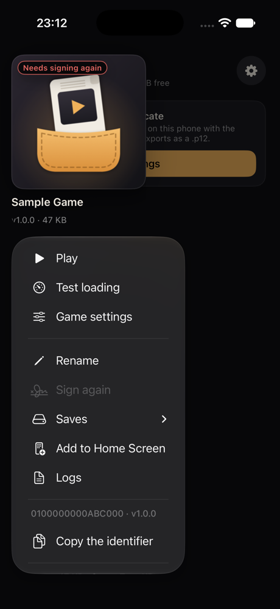

# NXPocketApple

Play your own Switch games on your iPhone. A Mac launcher builds them from your dumps; an iPhone app signs and runs
them, without reinstalling the app for each game.

> No keys, no firmware, no games included. Not an emulator: the game's code runs natively and Metal draws it.
> Not affiliated with Nintendo.

<p align="center">
  
  
  
  
</p>
<p align="center">
  
</p>

## Features

**Play**
- Native speed: the game's own code runs on the iPhone, Metal draws it. Touch controls with an editor.
- TV out, with the phone as the pad.
- *Cheats*: import an Atmosphère cheat file, switch each cheat on or off.
- Per-game detail: sessions, average frame rate, last-session chart (frame rate, heat, battery).

**Library**
- One app for every game: no reinstall per game; certificate-expiry notification.
- *Offload* a game to free space; its saves and settings stay. *Check and repair* fixes damaged files.
- Cloud tiles: **build a game on the Mac from the iPhone** and follow it in *Activity*.
- Quick actions for recent games, a Shortcuts action.

**Saves**
- Snapshot before each session; *Time Machine* restores one.
- Optional backup to your Mac or SFTP server, restored from there. Never touched by updates.

**Sharing** (all off by default, see below)
- Fetch games from your Mac, an SFTP server, a web library or an archive.
- Background downloads, speed and time left, pause and resume, differential updates.

**Launcher (Mac)**
- **Library**: built games, plus those in your games folder that can be built (dashed tiles).
- **Build**: queue with pause and cancel; the `<title ID>_build` work folder is deleted on success.
- **Server**: set up your own SFTP server and *Send to my server*, so the Mac need not be on.
- **Settings → Engine**: pick the engine from a menu (the stable NX2Apple release comes first).
- **iPhone app**: prepares the memory limit before the first install; gives the SideStore source link.
- **Saves**: copied by cable, or sent by a paired iPhone.

## What you need

- Apple silicon Mac, macOS 13+, full Xcode (not just the Command Line Tools).
- iPhone 15 Pro or newer, iOS 26+, with [SideStore](https://sidestore.io) or another signing store (FlareStore, …).
- Your own game dumps and your own `prod.keys`.

## Install

1. **Mac**
   - Download `NXPocketApple-macOS.zip` from the [latest release](https://github.com/Absenti/NXPocketApple/releases/latest)
     and move `NXPocketApple.app` to Applications.
   - Clear the quarantine once (the app is ad-hoc signed, not notarized):
     ```bash
     xattr -dr com.apple.quarantine /Applications/NXPocketApple.app
     ```
     Or open it, then *System Settings → Privacy & Security → Open Anyway*.
   - Open it and follow **Setup**: it installs Python, XcodeGen and the engine for you (pinned, checked, no Homebrew, no admin password).
2. **iPhone**
   - In SideStore, add the source and install NXPocketApple from it:
     `https://github.com/Absenti/NXPocketApple/releases/latest/download/source.json`
   - Or use the launcher's **iPhone app** screen: it keeps the latest IPA, ready to sign with your own store.
   - Never open the IPA from Files: iOS installs a second copy that won't start.
3. **Certificate**
   - Export the `.p12` of the certificate that signed the app (SideStore: export it; other stores: the one you were given).
   - Import it in the iPhone app: *Settings → Certificate*.
4. **Games**
   - In the launcher, pick your games folder and `prod.keys`, build, then send.

Updates: the launcher updates itself from GitHub releases; SideStore updates the iPhone app from the source above.

## Getting games onto the iPhone

The launcher can **send** a built game over USB or Wi-Fi. The iPhone can also **fetch** it from sources you add with the library's **+**
(network features are off until you turn them on):

- **Your Mac**: *Settings → Sharing* in the launcher. Pair with the QR code, the number shown on both screens, or the six-digit code. TLS 1.3, the iPhone pins the Mac's key.
- **An SFTP server** (NAS, seedbox…): password or ed25519 key, server key fingerprint checked first, folder picked on the iPhone. No plain FTP.
- **A web library**: a folder exported by the launcher (*Server → A web copy of my built games*) behind a private https address.
- **An archive**: `.zip`, `.tar`, `.tar.gz` or a folder, from Files, AirDrop or a link, with an optional SHA-256 check. No 7z or RAR.

Downloads:

- Show speed and time left; can be paused, cancelled and resumed.
- Mac and web downloads continue while you use another app; SFTP pauses about 30 s after you leave.
- Everything is verified like a game sent by the Mac. Saves are never touched.
- A game rebuilt in a newer version shows *Update* and downloads only what changed.

Design and limits: [`docs/SHARING.md`](docs/SHARING.md).

## Build from source

```bash
tools/bootstrap.sh                     # engine and patches
tools/build_mac.sh --app               # launcher -> mac/.build/NXPocketApple.app
tools/build_zsign.sh                   # on-device signer (zsign + OpenSSL, pinned)
tools/build_app.sh --device-unsigned   # IPA for SideStore
```

- Tests: `swift test --package-path core`, `swift test --package-path mac`, `tools/test_app.sh`.
- Release: bump `VERSION`, push tag `v<VERSION>`; CI builds and publishes everything.

## Docs

[Architecture](docs/ARCHITECTURE.md) · [Package format](docs/PACKAGE.md) · [Sharing](docs/SHARING.md) · [Signing](docs/SIGNING.md)

## License

MIT. Built on nxnative and NX2Apple (MIT); credits in [`NOTICE`](NOTICE).
