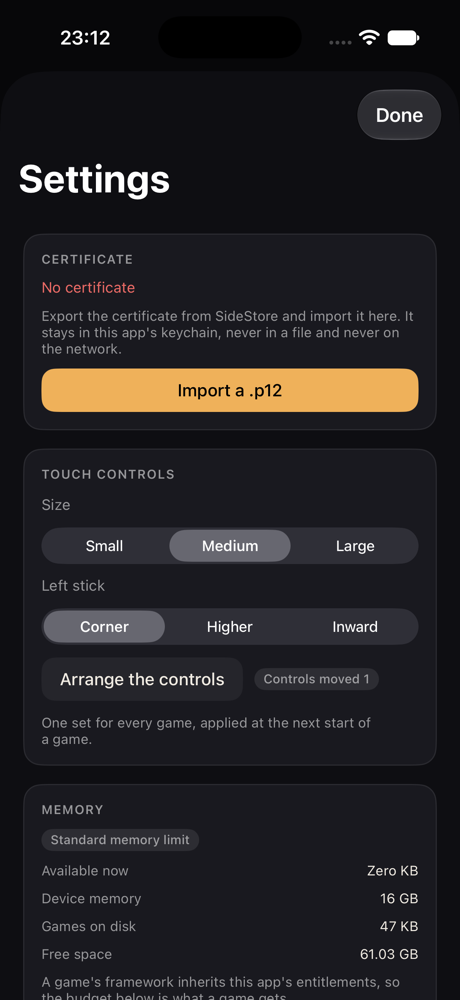

# NXPocketApple

Play your own Switch games on your iPhone. A Mac launcher builds them from your dumps; an iPhone app signs and runs
them, without reinstalling the app for each game.

> No keys, no firmware, no games included. Not an emulator: the game's code runs natively and Metal draws it.
> Not affiliated with Nintendo.

<p align="center">
  
  
  
  
</p>
<p align="center">
  
</p>

## How it works

| | |
|---|---|
| **Launcher** (`mac/`) | Turns a dump (NSP, XCI, folder) into a `.nxgame` package with the [nxnative](https://github.com/seedds/nxnative) engine and sends it to the iPhone over USB or Wi-Fi, or serves it to the iPhone and to your own server. Backs up your saves. |
| **iPhone app** (`app/`) | Verifies each package, signs its code on the device with your own certificate, and plays it. |
| **Core** (`core/`) | The package format, the Mach-O security policy and the RomFS identity, shared and tested on their own. |

## Requirements

- Apple silicon Mac, macOS 13+, full Xcode (the Command Line Tools are not enough).
- iPhone 15 Pro or newer, on iOS 26+, with [SideStore](https://sidestore.io) or another signing store (FlareStore, …):
  what matters is the `.p12` of the certificate that signed the app.
- Your own dumps and your own `prod.keys`.

## Install

1. **Mac:** download `NXPocketApple-macOS.zip` from the [latest release](https://github.com/Absenti/NXPocketApple/releases/latest),
   move `NXPocketApple.app` to Applications, and clear the download quarantine once (see below). Its **Setup** screen
   installs the rest (Python, XcodeGen, the engine), every download pinned and checked. No Homebrew, no admin password.
2. **iPhone:** the launcher's **iPhone app** screen keeps the latest iPhone app (the release's IPA, checked against its
   SHA-256) up to date by itself: copy it to iCloud Drive and install it from SideStore's **+** (or sign and install it
   with your own store). Or, in SideStore, add this source and install NXPocketApple from it:
   `https://github.com/Absenti/NXPocketApple/releases/latest/download/source.json`
3. Get the `.p12` of the certificate that signed the app (in SideStore: export it; with another store, use the one it
   gave you), then import it in NXPocketApple: **Settings → Certificate**.
4. In the launcher, pick your games folder and `prod.keys`, build, and send.

Never install the IPA by opening it from Files: iOS installs a second copy that will not start.

### "Apple could not verify NXPocketApple is free of malware"

The launcher is signed ad hoc, not notarized by Apple (that needs a paid Developer ID), so macOS blocks it the first
time. Either run, once:

```bash
xattr -dr com.apple.quarantine /Applications/NXPocketApple.app
```

or open it, then **System Settings → Privacy & Security → Open Anyway**. Updates installed by the launcher itself are
not quarantined and open without this step.

## Getting games onto the iPhone

The launcher can **send** a built game over USB or Wi-Fi. The iPhone can also **fetch** it, from sources you add with the library's **+** button (all network features are off until you turn them on):

- **Your Mac.** *Settings → Sharing* in the launcher shares the folder your games are built into, read-only, with iPhones you paired, on your local
  network. Pair by scanning the QR code with the iPhone's Camera (or compare the number both screens show, or type the six-digit code). Traffic is TLS 1.3
  and the iPhone pins the Mac's key; *Revoke* removes an iPhone, *Reset* makes a new key. macOS asks once to allow incoming connections, and iOS asks for the local network.
- **An SFTP server** (a NAS, a seedbox, any machine with an SSH server). Add it with a password or an ed25519 key, check the server's key fingerprint
  (shown before anything secret is sent, as `ssh` does) and pick the folder on the iPhone. It needs `aes-gcm`, `curve25519` and an ed25519 or ECDSA host key; plain FTP is not supported.
- **A web library**: a folder exported by the launcher (*Server → A web copy of my built games*) behind an https address only you know.
- **An archive you made yourself** (`.zip`, `.tar`, `.tar.gz`, or an unpacked folder), from Files, AirDrop, *Open in…* or a link, with an optional SHA-256 check;
  it is verified, installed and everything unpacked is removed. 7z and RAR are not read. The launcher's *Export as an archive…* makes one.

Downloads from the Mac and from a web library **go on while you are in another app**, even after the system stopped the app (the big files come over the
system's transfer service; the app is woken to check them); SFTP downloads pause about half a minute after you leave. Everything shows speed and time left,
can be paused, cancelled and resumed, and what arrives is verified exactly like a game the Mac sends; saves are never touched. A game a source has in a newer build shows
*Update* (only the blocks of its image that changed are downloaded). A download that loses its source (a sleeping Mac) goes on from another that has the same build.

## In the iPhone app

*Offload the game* keeps its tile, saves and settings while freeing the space. A snapshot of the saves is taken before each session and *Time Machine* puts one
back; saves can also be sent by themselves to your Mac or SFTP server, restored from there, and offered when another of your devices has newer ones (all off by default).
The game's detail shows the sessions, the average frame rate and a chart of the last session (frame rate, heat, battery), and *Check and repair the game*
fetches again only its damaged parts. *Cheats* in a game's menu imports an Atmosphère cheat file, checks it the way the engine reads it, and switches each cheat on or off.
A notification warns a day before the certificate runs out. A TV plugged in shows the game with the phone as the pad. A long press on the icon offers the three
games played last, and Shortcuts has a *Play a game* action. From the cloud tiles, a game the Mac has the dump of but has not built can be **built on the Mac from the
iPhone** (the Mac's switch is on by default; the iPhone says when it is off), and *Activity* follows the build.

## In the launcher

The **Library** also lists the games in your games folder that can be built (dashed tiles), and the **Build** queue deletes a game's work folder (`<title ID>_build`) when it succeeds.
The **Server** tab sets up your own SFTP server the way the iPhone does (password or key file, server key shown first, folder chosen by browsing) and *Send to my server*
puts a built game there, so the phone downloads it from there and the Mac need not be on. *Settings → Engine* picks the engine from a menu (the stable NX2Apple release
this launcher is made for comes first, and can be installed from there). The **iPhone app** screen gets the memory limit ready before the first install and
gives the SideStore source link to copy. Saves are copied from the iPhone by cable, or arrive by themselves from a paired iPhone
(*Settings → Sharing → Accept copies of saves from iPhones*, kept in `Built games/Saves/<title ID>/`).

Design, limits and what each party can and cannot do: [`docs/SHARING.md`](docs/SHARING.md).

## Updates

The launcher updates itself from GitHub releases. SideStore updates the iPhone app from the source above.

## Build from source

```bash
tools/bootstrap.sh                     # engine and patches
tools/build_mac.sh --app               # launcher -> mac/.build/NXPocketApple.app
tools/build_zsign.sh                   # on-device signer (zsign + OpenSSL, pinned)
tools/build_app.sh --device-unsigned   # IPA for SideStore
```

Tests: `swift test --package-path core`, `swift test --package-path mac`, and `tools/test_app.sh` for the iPhone app (see
[`docs/ARCHITECTURE.md`](docs/ARCHITECTURE.md)). Releases: bump `VERSION`, push tag `v<VERSION>`; CI builds and
publishes everything.

## Docs

[Architecture](docs/ARCHITECTURE.md) · [Package format](docs/PACKAGE.md) · [Sharing](docs/SHARING.md) · [Signing](docs/SIGNING.md)

## License

MIT. Built on nxnative and NX2Apple (MIT); credits and third-party notices in [`NOTICE`](NOTICE).
