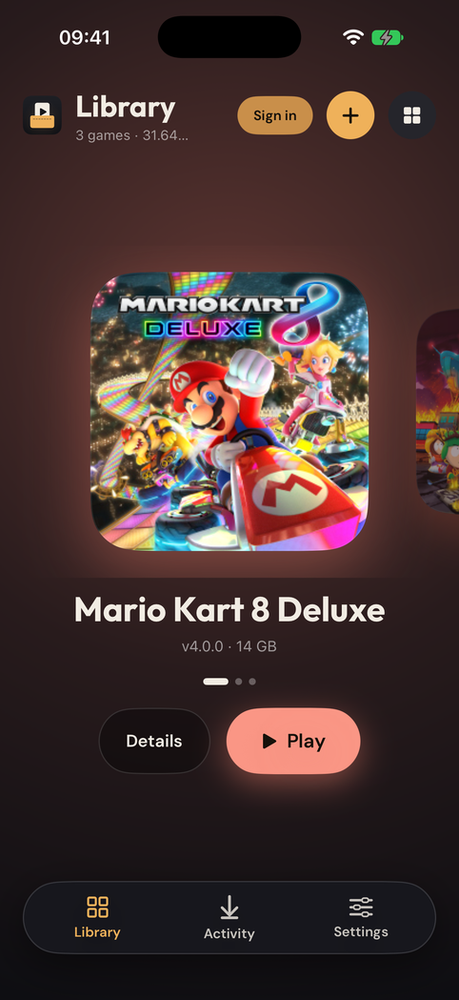
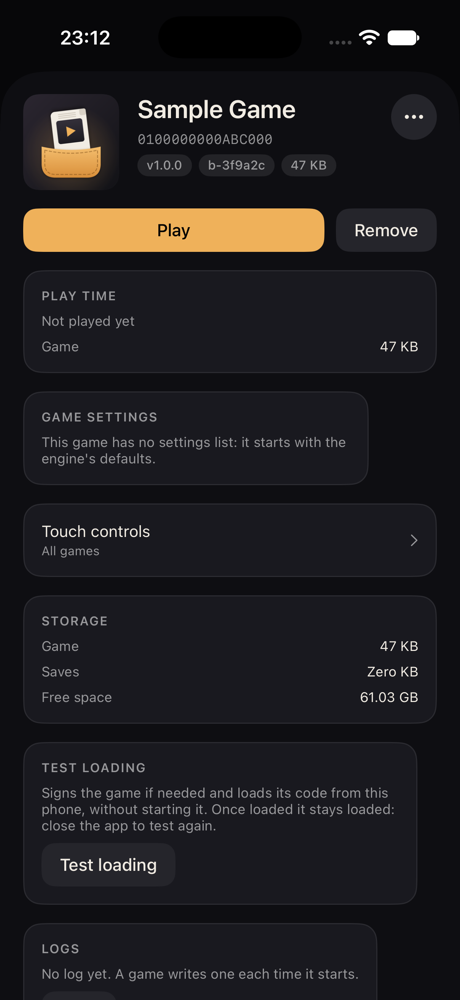
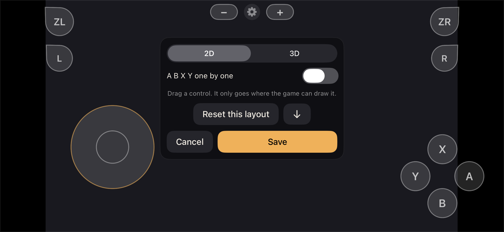

# NXPocketApple

Play your own Switch games on your iPhone. A Mac launcher builds them from your dumps; an iPhone app signs and runs
them, without reinstalling the app for each game.

> No keys, no firmware, no games included. Not an emulator: the game's code runs natively and Metal draws it.
> Not affiliated with Nintendo.

<p align="center">
  
  
  
  
</p>
<p align="center">
  
</p>

## How it works

| | |
|---|---|
| **Launcher** (`mac/`) | Turns a dump (NSP, XCI, folder) into a `.nxgame` package with the [nxnative](https://github.com/seedds/nxnative) engine and sends it to the iPhone over USB or Wi-Fi. Backs up your saves. |
| **iPhone app** (`app/`) | Verifies each package, signs its code on the device with your own certificate, and plays it. |
| **Core** (`core/`) | The package format, the Mach-O security policy and the RomFS identity, shared and tested on their own. |

## Requirements

- Apple silicon Mac, macOS 13+, full Xcode (the Command Line Tools are not enough).
- iPhone 15 Pro or newer, on iOS 26+, with [SideStore](https://sidestore.io) or another signing store (FlareStore, …):
  what matters is the `.p12` of the certificate that signed the app.
- Your own dumps and your own `prod.keys`.

## Install

1. **Mac:** download `NXPocketApple-macOS.zip` from the [latest release](https://github.com/Absenti/NXPocketApple/releases/latest),
   move `NXPocketApple.app` to Applications, and clear the download quarantine once (see below). Its **Setup** screen
   installs the rest (Python, XcodeGen, the engine), every download pinned and checked. No Homebrew, no admin password.
2. **iPhone:** the launcher's **iPhone app** screen keeps the latest iPhone app (the release's IPA, checked against its
   SHA-256) up to date by itself: copy it to iCloud Drive and install it from SideStore's **+** (or sign and install it
   with your own store). Or, in SideStore, add this source and install NXPocketApple from it:
   `https://github.com/Absenti/NXPocketApple/releases/latest/download/source.json`
3. Get the `.p12` of the certificate that signed the app (in SideStore: export it; with another store, use the one it
   gave you), then import it in NXPocketApple: **Settings → Certificate**.
4. In the launcher, pick your games folder and `prod.keys`, build, and send.

Never install the IPA by opening it from Files: iOS installs a second copy that will not start.

### "Apple could not verify NXPocketApple is free of malware"

The launcher is signed ad hoc, not notarized by Apple (that needs a paid Developer ID), so macOS blocks it the first
time. Either run, once:

```bash
xattr -dr com.apple.quarantine /Applications/NXPocketApple.app
```

or open it, then **System Settings → Privacy & Security → Open Anyway**. Updates installed by the launcher itself are
not quarantined and open without this step.

## Downloading from the iPhone

Besides the Mac sending a game, the iPhone can fetch it. Two sources, both off until you turn them on:

- **Your Mac.** *Settings → Sharing* in the launcher (off by default) shares the folder your games are built into,
  read-only, to iPhones you paired, on your local network. To pair, scan the QR code the launcher shows with the iPhone's Camera
  (or, if you cannot scan, compare the number both screens show, or type the six-digit code), and the games it has built
  show up in the library as cloud tiles, with their size and whether you already have that version. Traffic is TLS 1.3 and the iPhone pins the Mac's key; *Revoke* removes an iPhone, *Reset* makes a new key.
  The first time, macOS asks to allow incoming connections, and iOS asks for the local network: allow both.
- **An SFTP server** that holds your built `<title ID>.nxgame` folders: a NAS with its SSH or SFTP service on, a seedbox,
  any machine with an SSH server. Add the server and sign in with a password or an ed25519 key, check the server's key
  fingerprint (it is shown before anything secret is sent, as `ssh` does) and pick the folder on the iPhone. The key is
  pinned from then on. The server needs `aes-gcm`, `curve25519` and an ed25519 or ECDSA host key, which any OpenSSH from
  the last decade has; plain FTP is not supported.

Downloads show progress and can be paused, cancelled and resumed, even after the app was closed; the free space is
checked first, saves are never touched, and what arrives is verified exactly as a game the Mac sends. The downloader
keeps the screen awake, and uses the half minute iOS grants after you leave the app before pausing. Several games can be ticked
and download one after the other; a game a source has in a newer build shows *Update* (*Update all*, or *Update games by
themselves* in the Sources card, off by default); a notification tells you when the queue stopped while the app was in the
background.

**More in the iPhone app** (details in [`docs/SHARING.md`](docs/SHARING.md)): *Offload the game* keeps its tile, saves and settings
while freeing the space; a snapshot of the saves is taken before each session and *Time Machine* puts one back; the game's detail
shows the sessions and the average frame rate; a notification warns a day before the certificate runs out; and a TV plugged in shows
the game with the phone as the pad. From the cloud tiles, a game the Mac has the dump of but has not built can be built from the
iPhone (off by default on the Mac), and an update of a game you already have downloads only the blocks of its image that changed.

Also: *Check and repair the game* fetches again only the damaged parts of its data; a download that loses its source (a sleeping Mac)
goes on from the NAS; the detail shows a chart of the last session (frame rate, heat, battery); a long press on the app's icon offers
the three games played last, and Shortcuts has a *Play a game* action (so a game can be put on the home screen from there); and saves
can be sent by themselves after you played, restored from the Mac or NAS, and offered when another of your devices has newer ones.

**Archives and your own server.** The library's *plus* button (*Import an archive*) unpacks a `.zip`, `.tar` or `.tar.gz` of a build you made yourself (from Files or from
an https link only you know), checks it, installs it and removes everything it unpacked; 7z and RAR are not read. In the launcher, the *Server* tab (a password or a key, the server's key shown first, the folder chosen by browsing) and *Send to my server* put a built game on your NAS, so the phone downloads it from there.

**More ways to move your own builds**: the launcher's *Export as an archive…* gives a `.zip` and its SHA-256; the iPhone checks the hash before it unpacks
(an optional field), opens archives sent by AirDrop or *Open in…*, imports an unpacked folder, and resumes a link download the network cut. *A web copy of my
built games* exports a folder any https server can serve, which the iPhone adds as a *Web library*. *Cheats* in a game's menu imports an Atmosphère cheat
file, checks it the way the engine reads it, and switches each cheat on or off for the next start.

**Saves.** A game's menu (*Saves → Back up the saves to…*) and a source's menu (*Back up all my saves*) send a copy of the saves to
your Mac (*Settings → Sharing → Accept copies of saves from iPhones*, on with sharing; kept in `Built games/Saves/<title ID>/`) or
to your SFTP server (in a hidden `.nxpocket-saves` folder beside the games). The last ten copies of each game are kept, and a copy
is a .zip that *Import the saves* takes back from Files. Details, limits and what each party can and cannot do:
[`docs/SHARING.md`](docs/SHARING.md).

## Updates

The launcher updates itself from GitHub releases. SideStore updates the iPhone app from the source above.

## Build from source

```bash
tools/bootstrap.sh                     # engine and patches
tools/build_mac.sh --app               # launcher -> mac/.build/NXPocketApple.app
tools/build_zsign.sh                   # on-device signer (zsign + OpenSSL, pinned)
tools/build_app.sh --device-unsigned   # IPA for SideStore
```

Tests: `swift test --package-path core`, `swift test --package-path mac`, and `tools/test_app.sh` for the iPhone app (see
[`docs/ARCHITECTURE.md`](docs/ARCHITECTURE.md)). Releases: bump `VERSION`, push tag `v<VERSION>`; CI builds and
publishes everything.

## Docs

[Architecture](docs/ARCHITECTURE.md) · [Package format](docs/PACKAGE.md) · [Sharing](docs/SHARING.md) · [Signing](docs/SIGNING.md)

## License

MIT. Built on nxnative and NX2Apple (MIT); credits and third-party notices in [`NOTICE`](NOTICE).
